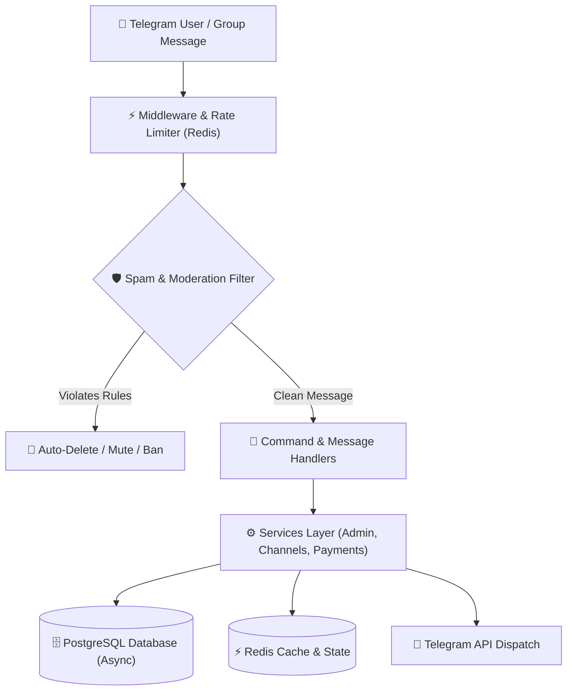

<div align="center">

# 🛡️ Spam Protector Bot

### **High-Performance Telegram Group Moderation, Anti-Raid & Spam Defense Engine**

[](https://www.python.org/)
[](https://www.postgresql.org/)
[](https://redis.io/)
[](https://core.telegram.org/bots/api)
[](LICENSE)

<p align="center">
  <b>An enterprise-ready Telegram moderation and anti-spam protection bot built with Python, PostgreSQL, and Redis. Features real-time rate monitoring, automated flood protection, UPI subscription billing, and multi-chat administration.</b>
</p>

[⚡ Core Features](#-core-features) • [🏗️ Architecture](#️-architecture) • [🚀 Quick Start](#-quick-start) • [⚙️ Configuration](#️-configuration) • [💳 Monetization](#-subscription--payments)

<br/>

**Repository**
[sumaldevservices-alt/spam-protector-bot](https://github.com/sumaldevservices-alt/spam-protector-bot)

</div>

---

## ⚡ Core Features

| Feature | Description |
| :--- | :--- |
| 🛡️ **Intelligent Moderation** | Real-time spam detection, link filtering, bad-word suppression, and automated warnings. |
| ⚡ **Anti-Raid & Flood Defense** | High-velocity raid detection and join-request validation to shield communities. |
| 🚀 **Redis Rate Limiting** | Low-latency in-memory rate tracking to throttle spam bursts before database writes. |
| 🗄️ **Async PostgreSQL Storage** | Robust relational persistence for users, groups, settings, and audit logs. |
| 💳 **Subscription & Monetization** | Built-in free trial management with automated UPI payment verification and QR support. |
| 📡 **Webhook & Polling Modes** | Production-ready webhook listener with configurable ports and local polling fallbacks. |
| 🎛️ **Granular Admin Controls** | Custom channel requirements, ban/mute overrides, and whitelist controls. |

---

## 🏗️ Architecture



---

## 🚀 Quick Start

### 1. Prerequisites
- **Python 3.10+**
- **PostgreSQL** instance
- **Redis** server
- Telegram Bot Token from [@BotFather](https://t.me/BotFather)

### 2. Clone the Repository
```bash
git clone https://github.com/sumaldevservices-alt/spam-protector-bot.git
cd spam-protector-bot
```

### 3. Create & Activate Virtual Environment
```bash
python3 -m venv venv
source venv/bin/activate    # On Windows: .\venv\Scripts\activate
```

### 4. Install Dependencies
```bash
pip install -r requirements.txt
```

### 5. Setup Configuration
Copy or create `.env` in the root directory:
```bash
cp .env.example .env 2>/dev/null || touch .env
```

Fill in the required variables (see below).

### 6. Run the Bot
```bash
python -m bot.main   # Or python main.py depending on entry point
```

---

## ⚙️ Configuration (.env)

| Variable | Required | Default | Description |
| :--- | :---: | :--- | :--- |
| `BOT_TOKEN` | ✅ | — | Telegram Bot Token from @BotFather |
| `DATABASE_URL` | ✅ | — | Async PostgreSQL connection string (`postgresql+asyncpg://...`) |
| `REDIS_URL` | ❌ | `redis://localhost:6379` | Redis connection URL |
| `SUPER_ADMIN_IDS` | ❌ | `[]` | List of Telegram User IDs with master control |
| `WEBHOOK_URL` | ❌ | `""` | Public HTTPS URL for Webhook mode (optional) |
| `WEBHOOK_PORT` | ❌ | `8080` | Local port for webhook server |
| `UPI_ID` | ❌ | `akash-sumal@fam` | UPI ID for automated subscription payments |
| `QR_CODE_URL` | ❌ | `...` | Hosted payment QR image URL |
| `FREE_TRIAL_DAYS` | ❌ | `3` | Trial duration for newly registered groups |

---

## 💳 Subscription & Payments

The bot features a self-sustaining business model:
1. **Free Trial:** When added to a new group, a 3-day full-access trial activates automatically.
2. **Subscription Plans:** Configurable monthly/yearly tiers for group owners.
3. **Automated Verification:** Seamless integration with UPI and QR code workflows for automated approval and activation.

---

## 🛡️ Security Best Practices

- **Strict Secret Isolation:** All sensitive credentials (`BOT_TOKEN`, `DATABASE_URL`) are read via Pydantic settings from environment variables.
- **Async Concurrency:** Built entirely on non-blocking async operations to prevent slow I/O from choking bot responsiveness.
- **Fail-Safe Caching:** Redis buffers incoming spikes to protect database connections during raid scenarios.

---

## 📜 License

Distributed under the **MIT License**. See `LICENSE` for more information.

<div align="center">
  <sub>Developed & Maintained by <b>Sumal Dev Services</b></sub>
</div>
